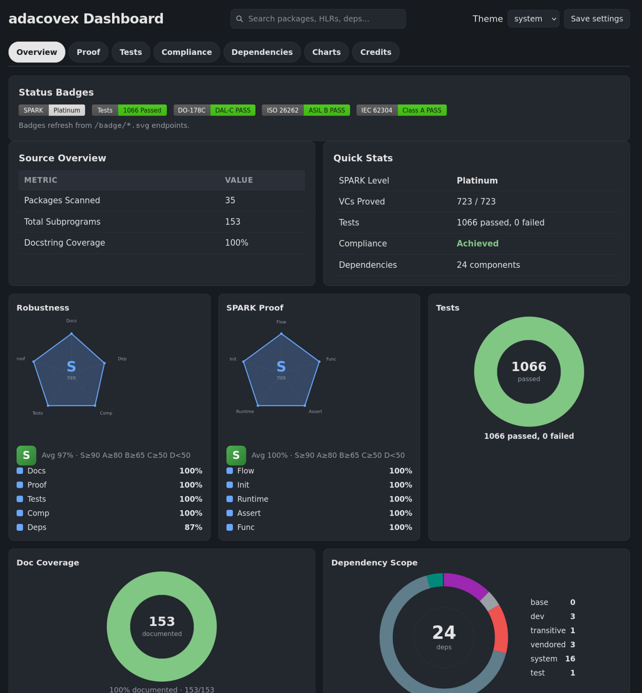
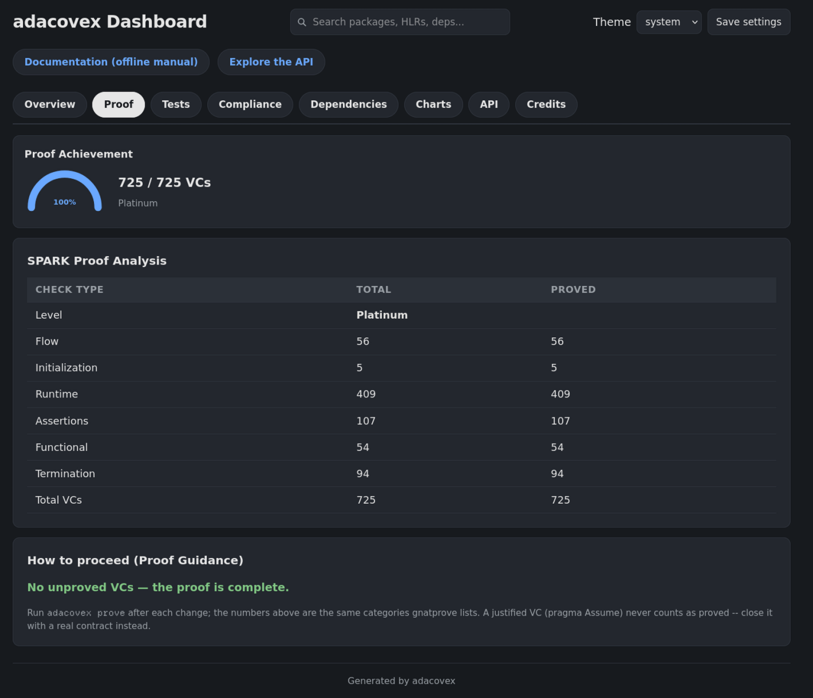
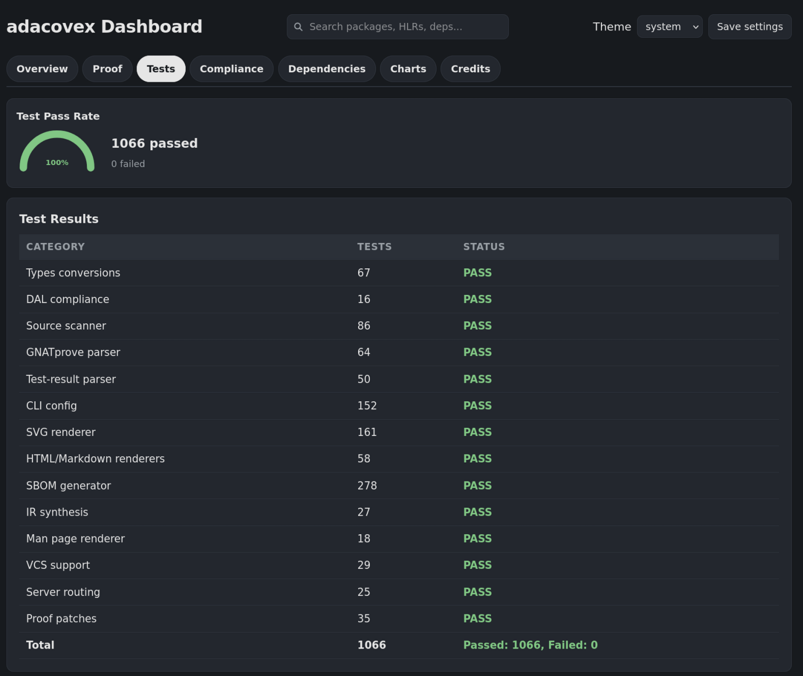
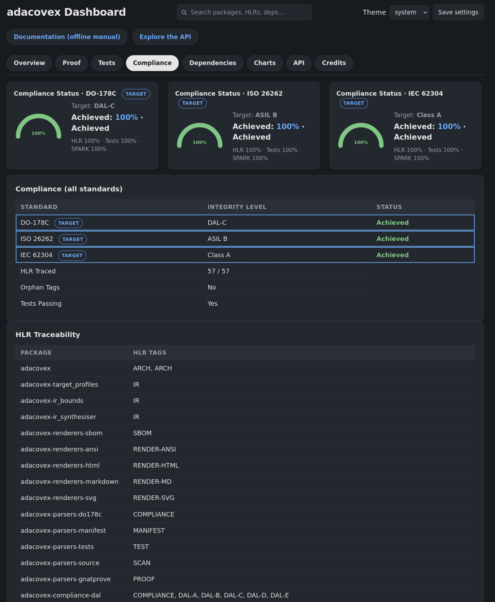
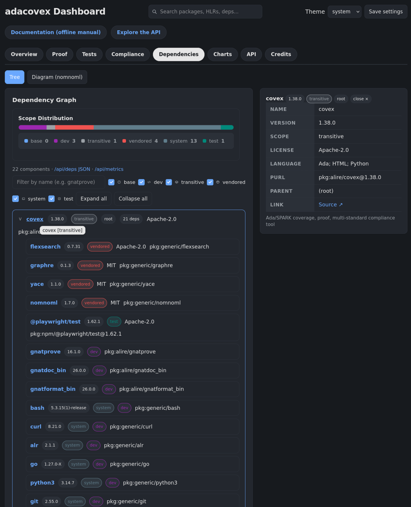
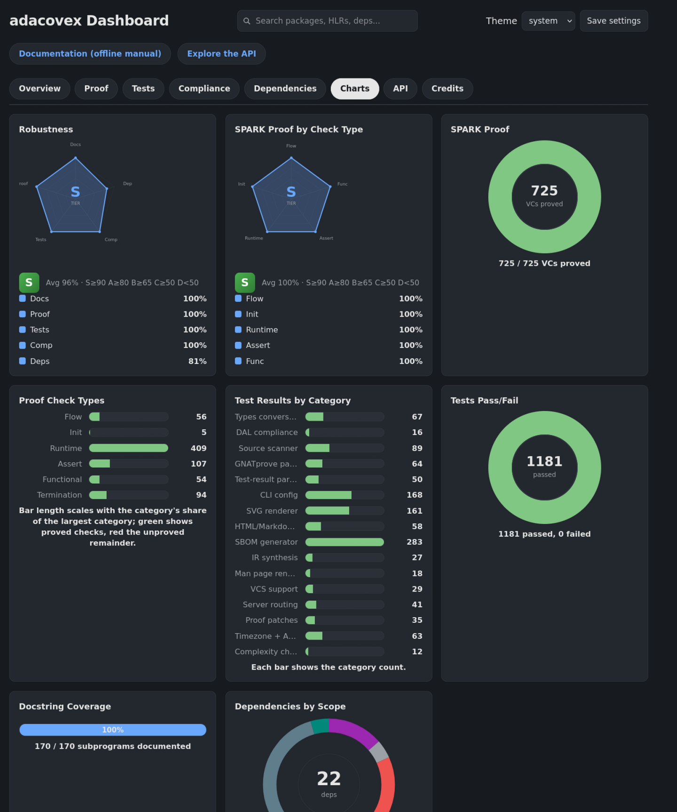
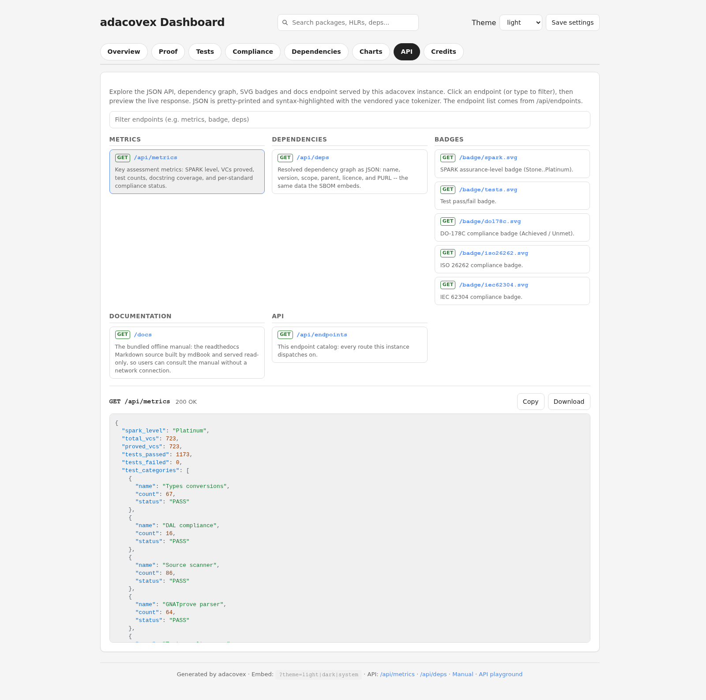

# Web dashboard and JSON API

`adacovex --target=. --serve --port=8080` runs the full assessment and then
starts a built-in HTTP/1.1 server (no external web stack) serving a
**viewable HTML dashboard**, a machine-readable JSON API, and the SVG
[badges](../glossary/ste100/tooling-terms.md#technical-name-badge). The server blocks until interrupted -- run it in its own terminal
(or as a background process when scripting).

```bash
adacovex --target=. --serve --port=8080
# in another terminal:
curl http://localhost:8080/api/metrics
```

The dashboard guide is split across five pages. This page covers using
the served dashboard and its endpoint table. The dashboard document itself
(tabs, dependency views, split-view detail panel, search) is on
[The dashboard document and its dependency views](dashboard-html.md); the
JSON API, the API playground, and the themes are on
[The dashboard JSON API, playground, and themes](dashboard-api.md); the
chart cards and the robustness tier are on
[Dashboard metric charts](dashboard-charts.md); the bundled offline manual
and its compression and navigation are on
[The bundled offline manual](dashboard-docs.md).

## How to use the dashboard

Open `http://localhost:8080` in a browser. The page is a single self-contained
document (no external assets) with hash-routed tabs; the theme dropdown and
**Save settings** persist your choice.

### Overview tab



Start here. The **Status badges** row shows the same SVG badges the server
serves at `/badge/*.svg`, so a reader sees what a README will. **Source
Overview** counts the scanned packages, subprograms, and docstring coverage,
and **Quick Stats** repeats the five headline figures: SPARK level, VCs
proved, tests, compliance status, and dependency count.

The **Robustness tier** (S / A / B / C / D) is a single letter summarising
five quality axes: Docs, Proof, Tests, Comp, and Deps. **S** means healthy
across the board; **D** means an axis is below 50%. Below that:

- **SPARK radar** -- proved verification conditions per check category (flow,
  initialization, runtime, assertions, functional). A balanced polygon means
  every category has strong coverage; a spike in one corner and a flat line
  in another means the proof effort is uneven.
- **Tests donut** -- passed vs failed tests. A full green arc means 100%
  passing. Any red slice means the test suite has failures that must be fixed
  before the project can be assessed as `Achieved`.
- **Doc coverage donut** -- documented subprograms as a percentage of
  total. Strict mode requires 100%. A shortfall here shows exactly how many
  subprograms are missing `--` docstrings.
- **Dependency scope ring** -- the resolved graph broken down by scope
  (base / dev / transitive / vendored / system / test), hoverable per
  segment (hover shows the scope name and its component count, for
  example `test: 3`).

Proof check bars scale with the category's magnitude, the same way as the
test-category bars: a 407-VC category reads as a longer bar than a 56-VC
one, so relative proof effort is visible at a glance.

### Proof tab



Leads with a **Proof Achievement** gauge: the proved share, the VCs proved
out of the total, and the assessed SPARK level (Stone .. Platinum). Below it,
the **SPARK Proof Analysis** table repeats gnatprove's own check-type rows
(flow, initialization, runtime, assertions, functional, termination) with
total and proved counts. **Proof Guidance** states the next action, and
**SPARK Proof Coverage** reads the coverage report by file: statements,
subprograms, VCs, and the three off classes. The prover never runs while the
page is served -- the numbers come from `obj/gnatprove/`.

### Tests tab



Every test category with its count and Pass / Fail. A single failing category
is enough to fail the compliance gate (`Tests passing` must be `Yes` for
every tier except QM / DAL-E).

### Compliance tab



A **Compliance Status** gauge per standard (DO-178C, ISO 26262, IEC 62304)
with the target level and the achieved share, then one **Compliance** table:
every standard's level and status, HLRs traced, orphan-tag state, tests, and
one `Failure` row per unmet criterion. **HLR Traceability** lists the tags each
package carries. Use this to verify that every HLR is tagged in source and
that no tags are orphaned (tagged but not defined in `compliance/HLR.md`).

### Dependencies tab



An interactive dependency tree (or diagram) of every component in the graph.
Use the filter input and scope checkboxes to focus on a scope; click a node
to see its licence, PURL, parent, and a registry link. Use this tab to audit
your supply chain: confirm every vendored licence is compatible, see which
system tools the build needs (the `system` scope), and trace each component
back to its source.

The diagram view (toggle **Tree / Diagram**) renders the same graph as a directed diagram.

### Charts tab



Eight CSS-only cards show the same data as the Overview tab in a different
format. See [Dashboard metric charts](dashboard-charts.md#metrics-charts) for
the full card-by-card breakdown.

### API tab



An interactive REST API playground: every endpoint the server dispatches on
as a searchable, clickable button, with a pretty-printed, syntax-highlighted
JSON preview. The first endpoint (`/api/metrics`) runs automatically. See
[The API playground](dashboard-api.md#api-playground) for the full detail.

### Credits tab

Lists the third-party libraries the dashboard bundles -- nomnoml, graphre,
FlexSearch, yace, and Charts.css -- each with its version, licence, and the
part it serves. Sphinx, MyST, and the Read the Docs hosting service appear
too, marked as build-time tools rather than bundled code. The tab links the
full legal text at [Third-Party Notices](../THIRD_PARTY_NOTICES.md), so the
attribution travels inside the offline binary.

## Interpreting the charts

- **Green / full arcs** -- the metric is at 100% or close to it.
- **Red slices or flat corners** -- there is a regression or missing data.
- **Scope rings** -- a large vendored wedge means strict-mode docstrings are
  being suppressed by patches.
- **Tier letter drops** -- the average across the five axes fell; check the
  axis table to see which one regressed.

The same data is headlessly available at `/api/metrics` and via
`--emit-metrics=PATH` (`{"metrics":..., "dependencies":...}`).

| Path | Content |
|------|---------|
| `GET /` | HTML dashboard (tabbed) |
| `GET /api/metrics` | JSON object with the key assessment metrics |
| `GET /api/deps` | JSON dependency graph (same data as the Dependencies tab) |
| `GET /api/endpoints` | JSON endpoint catalog (the list the API playground builds its UI from) |
| `GET /api/spark` | JSON SPARK proof coverage: the three metrics, off classes, and per-group rollups |
| `GET /api/info` | JSON server and run metadata: version, target, port, workers, uptime, cache counters, assessment time, and per-route request counters |
| `GET /api/watch` | JSON watch state: `watching`, and the document-refresh `generation` the page polls |
| `GET /health` | JSON health probe for scripts: `{"status": "ok"}` |
| `GET /docs` | The bundled offline manual (the Sphinx manual, built into the binary) |
| `GET /badge/spark.svg` | SPARK assurance level badge |
| `GET /badge/tests.svg` | Test pass/fail badge |
| `GET /badge/do178c.svg` | DO-178C compliance badge (Achieved / Unmet) |
| `GET /badge/iso26262.svg` | ISO 26262 compliance badge |
| `GET /badge/iec62304.svg` | IEC 62304 compliance badge |
| anything else | `404 Not Found` |

The server runs a small HTTP/1.1 implementation with a task pool that
scales to the host's logical CPU count within `2`..`8` workers (configurable
with [`--serve-workers=N`](cli-reference-options.md#--serve-workersn) or its
`--workers=N` alias) and serves
requests until the process is interrupted (Ctrl-C). Query strings and URL
fragments are stripped before routing, so `/?theme=light`,
`/api/metrics?x=1` and `/api/deps#top` reach the same handlers as `/`,
`/api/metrics` and `/api/deps` instead of 404ing.

With watch on (the default), the page polls `/api/watch` every two seconds and
reloads when the generation moves, so source edits show up without a manual
restart. Proof, test, and compliance panels keep the starting run's values.

Scripts poll [`GET /health`](dashboard-api.md#server-info-and-health) for the
liveness verdict and read `GET /api/info` for the counters of the running
server. Both stay on loopback with the rest of the dashboard: the server
binds `127.0.0.1` only.

The bundled offline manual served at `/docs` is documented on
[The bundled offline manual](dashboard-docs.md).

## Charts

The eight chart cards and the robustness tier are documented on
[Dashboard metric charts](dashboard-charts.md).
